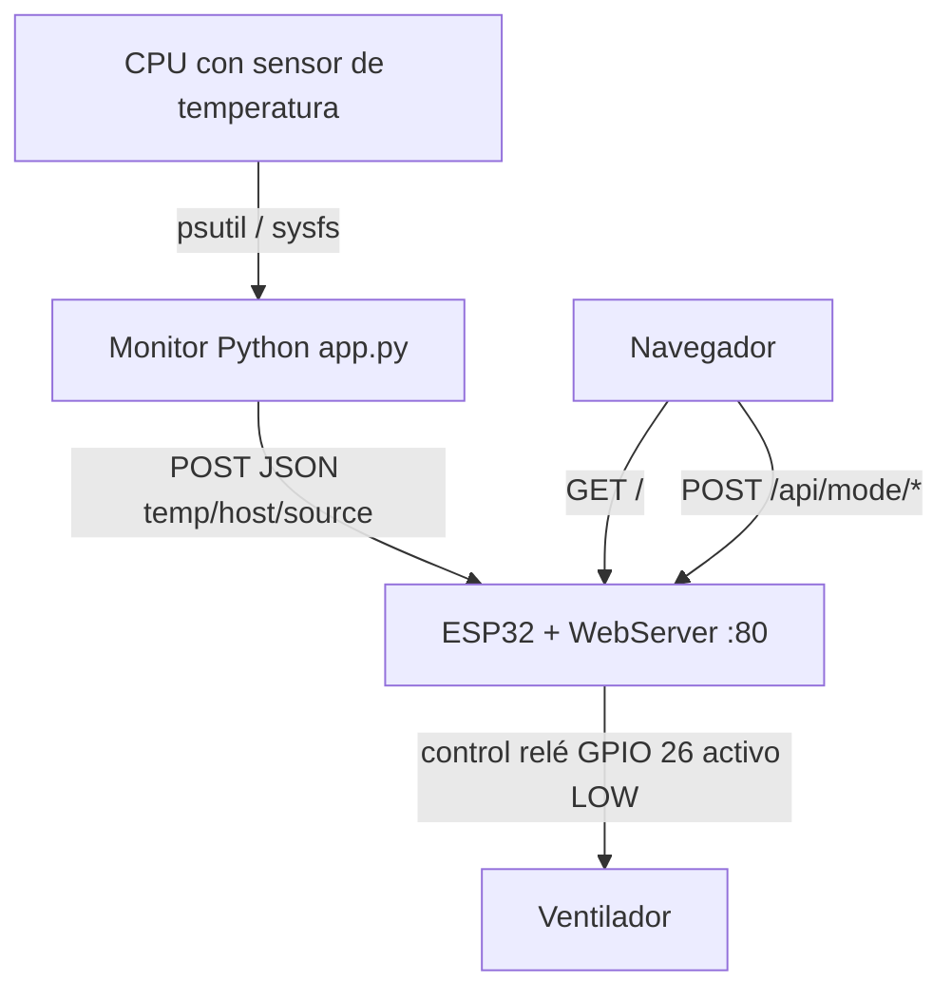

# esp32-fan-controller

Monitor de temperatura CPU que envía datos a un ESP32 para control de ventilación vía HTTP POST. Incluye firmware Arduino para el receptor ESP32 con control de relé y página web de administración.

[](https://python.org)
[](https://www.arduino.cc/)
[](https://github.com/bi0punk/esp32-fan-controller/actions)
[](LICENSE)

## Contenido

- [Características](#características)
- [Arquitectura](#arquitectura)
- [Stack](#stack)
- [Estructura del repositorio](#estructura-del-repositorio)
- [Instalación](#instalación)
- [Uso](#uso)
- [Firmware ESP32](#firmware-esp32)
- [API del ESP32](#api-del-esp32)
- [Modos de operación](#modos-de-operación)
- [Configuración](#configuración)
- [Tests / CI](#tests--ci)
- [systemd](#systemd)
- [Roadmap](#roadmap)
- [Licencia](#licencia)

## Características

- **Monitoreo CPU**: lectura de temperatura con `psutil` (con fallback a sysfs)
- **Backoff exponencial**: ante fallos de conexión (1s → 2s → 4s → 8s…)
- **Filtro delta**: evita envíos si temperatura no cambió significativamente
- **Graceful shutdown**: captura SIGINT/SIGTERM, cierra limpiamente
- **Connection pooling**: `requests.Session()` para reutilizar TCP
- **Histeresis**: evita oscilaciones del relé cerca del umbral
- **Logging rotativo**: opcionalmente escribe a archivo con rotación (1 MB, 3 backups)
- **Config flexible**: variables de entorno + CLI + defaults

## Arquitectura



Flujo: el monitor en la máquina host lee la temperatura de la CPU, la envía por HTTP POST al endpoint `/api/cpu` del ESP32; el firmware aplica lógica auto (histéresis con `TEMP_ON`/`TEMP_OFF`), conmuta el relé y expone una página web de control.

## Stack

| Componente | Tecnología |
|---|---|
| Monitor CPU | Python 3.11+, psutil, requests |
| Firmware receptor | ESP32 (Arduino framework) |
| Comunicación | HTTP POST (JSON) |
| Control | Relé (GPIO 26, activo LOW) |
| Testing | pytest (Python) |

## Estructura del repositorio

```
esp32-fan-controller/
├── app.py                  # Monitor Python principal
├── esp32/
│   ├── fan_control.ino     # Firmware ESP32
│   ├── wifi_config.example.h  # Template WiFi (copia a wifi_config.h)
│   └── .gitignore          # Ignora wifi_config.h
├── tests/
│   ├── __init__.py
│   └── test_app.py         # 18 tests con mocks
├── .env.example
├── .github/workflows/ci.yml
├── pyproject.toml
├── requirements.txt
└── README.md
```

## Instalación

### Requisitos

Monitor Python:
- Python 3.11+
- CPU con sensor de temperatura

ESP32:
- Placa ESP32 (ESP32-WROOM, ESP32-S, etc.)
- Relé (activo en LOW) conectado a GPIO 26
- Arduino IDE o PlatformIO para flashear

### Monitor Python

```bash
pip install -r requirements.txt
```

### Firmware ESP32

Las credenciales WiFi no están hardcodeadas. Copia el archivo de ejemplo y edítalo:

```bash
cp esp32/wifi_config.example.h esp32/wifi_config.h
# Edita esp32/wifi_config.h con tu SSID y password
```

`wifi_config.h` está en `.gitignore` y no se sube al repositorio.

## Uso

```bash
python app.py --ip 10.0.0.5 --interval 10 --verbose
```

## Firmware ESP32

### Pines

| Pin | Conexión |
|---|---|
| GPIO 26 | Relé (activo en LOW) |

## API del ESP32

| Método | Ruta | Descripción |
|---|---|---|
| GET | `/` | Página web de control |
| GET | `/api/state` | Estado JSON |
| POST | `/api/cpu` | Recibe `{"temp": 61.5}` |
| POST | `/api/mode/auto` | Modo automático |
| POST | `/api/mode/on` | Forzar encendido |
| POST | `/api/mode/off` | Forzar apagado |

## Modos de operación

- **AUTO** — Enciende ventilador cuando `temp >= TEMP_ON` (65°C), apaga cuando `temp <= TEMP_OFF` (55°C)
- **FORCE_ON** — Ventilador siempre encendido
- **FORCE_OFF** — Ventilador siempre apagado
- **Fail-safe:** Si no recibe datos del sensor por 30s, enciende el ventilador automáticamente

## Configuración

| Variable | Flag CLI | Default | Descripción |
|---|---|---|---|
| `ESP32_IP` | `--ip` | `192.168.1.103` | IP del ESP32 |
| `INTERVAL_SECONDS` | `--interval` | `5` | Intervalo entre envíos (s) |
| `HTTP_TIMEOUT_CONNECT` | — | `2` | Timeout conexión TCP (s) |
| `HTTP_TIMEOUT_READ` | — | `3` | Timeout lectura HTTP (s) |
| `TEMP_DELTA_THRESHOLD` | `--delta` | `0.5` | Umbral mínimo de cambio (°C) |
| `MAX_CONSECUTIVE_FAILURES` | — | `5` | Fallos antes de backoff máximo |
| `LOG_LEVEL` | `--verbose` | `INFO` | Nivel de logging |
| `LOG_FILE` | `--log-file` | — | Ruta a archivo de log |

## Tests / CI

CI: GitHub Actions ejecuta lint (Ruff) y tests (pytest) en cada push/PR.

```bash
pip install pytest
pytest tests/ -v
```

## systemd

```ini
[Unit]
Description=ESP32 CPU Temperature Monitor
After=network.target

[Service]
Type=simple
ExecStart=/usr/bin/python3 /opt/esp32-fan-controller/app.py
Restart=on-failure
RestartSec=10
User=root
EnvironmentFile=-/etc/default/esp32-monitor

[Install]
WantedBy=multi-user.target
```

## Roadmap

- [x] Monitoreo de CPU + control ESP32
- [x] Histeresis y backoff exponencial
- [x] Firmware ESP32 con fail-safe
- [ ] Soporte multi-sensor (GPU, disco)
- [ ] Dashboard web con histórico
- [ ] Notificaciones (telegram, email)
- [ ] Modo PWM para ventiladores sin relé
- [ ] Soporte MQTT como alternativa a HTTP

## Licencia

MIT — ver [LICENSE](LICENSE).